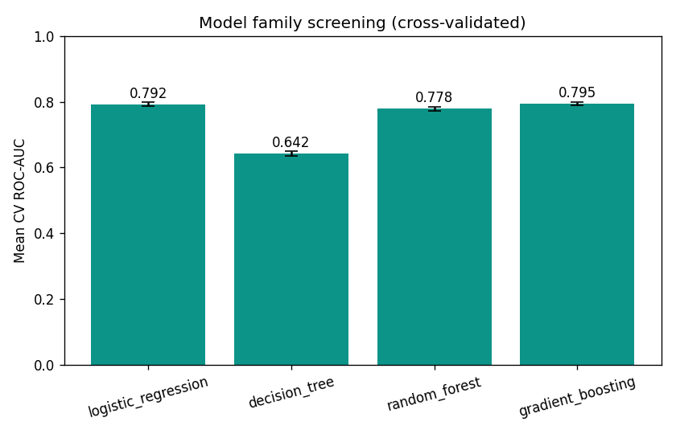
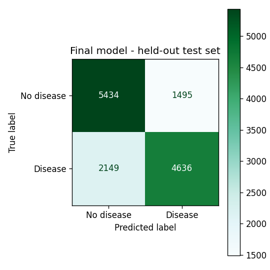
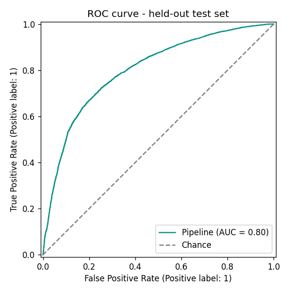

# ML Pipeline Methodology

Code: `ml/`. Dataset provenance: `ml/dataset/README.md`. 31 tests: `ml/tests/` (21 preprocessing,
2 metrics, 8 against the real saved model - see `STATUS.md` for how this was verified).

This document covers the offline model-training pipeline (Phase 4). It is **not** the rule-based
Health Score from Phase 3 (`docs/health-scoring.md`) - the two are separate, independently
computed numbers, described differently to the user, and must not be conflated.

## Dataset

Kaggle's "Cardiovascular Disease dataset" (70,000 records, 13 columns). Full selection reasoning,
feature descriptions, and limitations: `ml/dataset/README.md`. In short: a real (not toy) dataset
whose features - age, gender, height/weight, blood pressure, smoking, alcohol, activity - map
closely onto data this app already collects, with genuine data-quality issues that needed real
cleaning rather than being a pre-cleaned exercise.

**The most important limitation, repeated here because it matters most:** the dataset does not
document how its `cardio` label was determined (clinical diagnosis vs. self-report vs. something
else). The resulting model is a statistical association model trained on that label - not a
diagnostic tool, and it must never be presented as one.

## Preprocessing pipeline

```
raw CSV (70,000 rows)
  -> cleaner.clean_data()            drop id, drop duplicates, drop physiologically
                                      implausible values                          -> 68,598 rows
  -> feature_engineering.engineer_features()   age days->years, BMI, pulse pressure,
                                      mean arterial pressure, gender remap
  -> feature_engineering.drop_bmi_outliers()   joint height/weight implausibility -> 68,569 rows
  -> train/test split (80/20, stratified on the target, random_state=42)
  -> ColumnTransformer (preprocessing/pipeline.py): StandardScaler on continuous
     features, ordinal/binary features passed through unscaled
```

**Cleaning thresholds** (`config.RANGES`): height 120-220cm, weight 30-200kg, systolic BP
60-260mmHg, diastolic BP 30-200mmHg. The blood-pressure bounds deliberately match
`backend/app/schemas/health.py`'s `AssessmentCreate` validation, so the model is trained on the
same input domain the live app can actually submit. Rows are also required to have systolic >
diastolic (1,234 rows failed this in the raw data - a physical impossibility, not a matter of
threshold choice).

**Joint BMI filter:** height and weight can each be individually plausible yet combine into an
impossible BMI (e.g. 122cm/161kg -> BMI 108). Found by inspecting the tails of the cleaned data:
90 rows (0.13%) fell outside a deliberately wide BMI range of [14, 60] and were removed.

**Retention:** 68,569 of 70,000 raw rows survived cleaning (98.0%).

**Feature engineering:**
- `age_years = age_days / 365.25`
- `bmi = weight_kg / (height_cm/100)^2` - identical formula to the app's own generated
  `user_profiles.bmi` column (`database/schema.sql`), so "BMI" means the same thing everywhere
  in this project.
- `pulse_pressure = ap_hi - ap_lo`, `map_pressure = ap_lo + pulse_pressure/3` (mean arterial
  pressure) - standard derived cardiovascular indicators, included as engineered features
  alongside the raw readings.
- `gender`: dataset's undocumented {1, 2} convention remapped to {0=female, 1=male}.

**Scaling:** continuous features (`age_years, height_cm, weight_kg, bmi, ap_hi, ap_lo,
pulse_pressure, map_pressure`) are standardized; ordinal/binary features (`gender, cholesterol,
gluc, smoke, alco, active`) pass through unscaled. Implemented as an sklearn `ColumnTransformer`
wrapped in the same `Pipeline` as the classifier, so preprocessing and model are saved as **one**
artifact (`saved_models/best_model.joblib`) - this was a deliberate choice over saving a separate
scaler file: a single pipeline object removes the classic train/serve skew bug where inference
uses a different feature order or scaling than training.

## Models trained and compared

Four families, as required: Logistic Regression, Decision Tree, Random Forest, Gradient Boosting
(scikit-learn's `GradientBoostingClassifier`, not XGBoost/LightGBM - this satisfies the
requirement without an extra native-code dependency; see `ml/training/models.py`).

### A note on compute: this environment has a single CPU core

Confirmed via `nproc`. scikit-learn's `n_jobs` parallelism has no second core to use, and was
measured to make fits *slower* (worker processes competing for the one core). The pipeline was
therefore staged to stay within practical wall-clock time (~22 seconds total, measured):

1. **Screen** all 4 families with 3-fold cross-validation on a 6,000-row stratified subsample of
   the training set, to cheaply rank the architectures.
2. **Tune** only the winning family's hyperparameters via grid search, 3-fold CV, on a larger
   15,000-row subsample.
3. **Fit once** on the **full** 54,855-row training set with the winning hyperparameters.
4. **Evaluate once** on the **full**, untouched 13,714-row held-out test set.

Steps 3-4 use the complete data throughout - only the *comparison and tuning* steps use
subsamples, never the model that is actually saved or the metrics that are actually reported.
This is a documented adaptation to the available compute, not a shortcut that compromises the
final reported numbers.

### Screening results (3-fold CV, 6,000-row subsample)

| Model | ROC-AUC | Accuracy | F1 |
|---|---|---|---|
| Logistic Regression | 0.7920 (±0.0061) | 0.7320 | 0.7161 |
| Decision Tree | 0.6423 (±0.0067) | 0.6423 | 0.6367 |
| Random Forest | 0.7784 (±0.0065) | 0.7172 | 0.7096 |
| **Gradient Boosting** | **0.7947 (±0.0053)** | 0.7360 | 0.7236 |



**Gradient Boosting won** on mean CV ROC-AUC - the metric selected in advance as the tie-breaker
(`evaluation/comparison.pick_best`), not chosen after the fact from whichever metric looked best.

**Why the Decision Tree did so much worse (0.64 vs ~0.78-0.79 for the others):** verified rather
than assumed - a single unconstrained tree overfits a small training subsample. Re-running just
the tree at different depth limits on the same 6,000-row subsample:

| max_depth | CV ROC-AUC |
|---|---|
| None (unconstrained) | 0.6239 |
| 8 | 0.7318 |
| 6 | 0.7649 |
| 4 | 0.7784 |

Accuracy climbs monotonically as the tree is constrained, the signature of overfitting rather than
a fundamentally weaker model class. (The tree was not re-entered into the comparison at a fixed
depth, since it still would not be expected to beat the ensembles - this check exists to explain
the result honestly, not to rescue the model.)

### Hyperparameter tuning (winning model: Gradient Boosting)

Grid: `n_estimators in {100, 150}`, `max_depth in {2, 3}` (`training/models.py`), 3-fold CV on a
15,000-row subsample. **Best: `n_estimators=100, max_depth=3`**, CV ROC-AUC 0.8002.

### Final evaluation - held-out test set (13,714 rows, used exactly once)

| Metric | Value |
|---|---|
| Accuracy | 0.7343 |
| Precision | 0.7562 |
| Recall | 0.6833 |
| F1-score | 0.7179 |
| ROC-AUC | 0.8014 |

Confusion matrix (5,434 TN / 1,495 FP / 2,149 FN / 4,636 TP):




**External sanity check:** these numbers (≈73% accuracy, ≈0.80 ROC-AUC) fall squarely within the
range commonly reported by independent public analyses of this exact dataset (typically ~70-74%
accuracy, ~0.78-0.80 ROC-AUC for tree-based models). That consistency is evidence against a data
leakage or implementation bug - not proof of correctness on its own, but a meaningful cross-check
that was actually performed, not just asserted.

## Feature importance (sanity check, not the Phase 5 explainability feature)

From the final model's `feature_importances_`, inspected as a plausibility check that the model
learned something clinically sensible rather than noise:

| Feature | Importance |
|---|---|
| `ap_hi` (systolic BP) | 0.686 |
| `age_years` | 0.123 |
| `cholesterol` | 0.079 |
| `map_pressure` | 0.067 |
| (remaining 10 features) | combined ≈ 0.045 |

Blood pressure, age, and cholesterol dominating matches well-established cardiovascular risk
factors in the medical literature. `smoke`, `alco`, and `gender` carry very little importance in
*this* model - most likely because blood pressure and age already capture most of the predictable
signal on this dataset, not evidence that smoking or alcohol are clinically unimportant in
general. This is a plausibility check only; per-prediction SHAP explanations are Phase 5's job
("Explainable AI"), not this one.

## Reproducibility

`python ml/training/train.py` (from `ml/`) regenerates everything in this document: the same
`random_state=42` throughout (train/test split, CV folds, subsampling, every estimator) produced
identical results across repeated runs during development. Total run time ≈22 seconds on this
environment's single core.

## Saved artifacts

- `ml/saved_models/best_model.joblib` - the complete sklearn `Pipeline` (preprocessing + tuned
  Gradient Boosting classifier), loadable with `joblib.load()`.
- `ml/saved_models/model_info.json` - hyperparameters, dataset counts, final test metrics,
  training timestamp and duration.
- `ml/saved_models/model_comparison.json` - the full screening comparison table above, as
  structured data for Phase 9's admin ML-analytics dashboard to render directly (charts there are
  rendered live in the React UI from this JSON, not from the PNGs below).
- `ml/saved_models/plots/*.png` - the three diagnostic plots shown above, standard ML-report
  artifacts distinct from the Phase 9 dashboard.
- `ml/prediction/predictor.py` - `HealthRiskPredictor`, a thin loader/inference wrapper. Tested
  against the real saved artifact (`ml/tests/test_predictor.py`): correct output shape, raises
  clearly on missing input rather than guessing, deterministic, and - checked explicitly rather
  than assumed - risk increases monotonically with blood pressure and with age, holding
  everything else fixed.

## Integration note for Phase 5 (not yet done)

Wiring this model into the live API is Phase 5's job, but one gap is worth flagging now rather
than discovering it mid-integration: **the model's third-most-important feature is
`cholesterol`, and the app's schema currently has no field for it anywhere** (`users`,
`user_profiles`, `health_assessments` - checked against `database/schema.sql`). Two other
features need a translation, not a new field:

- `gluc` (the dataset's 3-level ordinal category) can be reasonably derived from the app's
  existing continuous `blood_glucose_mg_dl` using the same ADA-consistent thresholds already used
  by the Phase 3 score (`app/utils/health_score.py`: <70 low / 70-99 normal / 100-125 elevated /
  ≥126 high) - not a new data-collection need, but be aware it's an approximation (as already
  disclosed to users via `glucose_caveat` in Phase 3).
- `gender`: the app stores `MALE`/`FEMALE`/`OTHER`; the model only has two classes. `OTHER` has
  no principled mapping - Phase 5 will need to decide how to handle it (e.g. exclude the feature
  for those users and note the resulting lower `data_completeness`, mirroring how Phase 3 already
  handles partial data, rather than forcing a guess).

**Recommendation for Phase 5:** add an optional `cholesterol_level` field to `user_profiles`
(`NORMAL` / `ABOVE_NORMAL` / `WELL_ABOVE_NORMAL`), following the exact pattern already used for
`smoking_status` and `alcohol_consumption` - nullable, no default, so "not provided" is
represented honestly rather than assumed. Until a user provides it, the predictor should treat
`cholesterol` as missing input the same way Phase 3 treats missing profile data (exclude and
flag, never silently default to "normal" - a user with elevated cholesterol who was never asked
should not be scored as if they weren't).

## Phase 5: API integration and explainability

Code: `backend/app/services/prediction_service.py`, `backend/app/config/ml_settings.py`.
46 tests: `backend/tests/test_prediction_service.py` (translation layer, encodings, real-model
output shape and monotonicity) plus 6 integration tests in `backend/tests/test_health.py`
(through the real API: availability, persistence, point-in-time snapshot behaviour, cross-user
isolation). Live end-to-end HTTP verification also performed (register → incomplete profile →
withheld prediction with reasons → complete profile → high-risk vitals → `HIGH` prediction with
blood pressure as the dominant factor → persisted identically on refetch → unaffected by a later
profile change → 404 for another user).

### Train/serve decoupling

`backend/` does **not** import `ml/`'s Python package. The two are connected only by the saved
`best_model.joblib` artifact and a duplicated, documented `FEATURE_COLUMNS` list - checked for
drift by a test that imports `ml/config.py` directly (only inside the test, never in production
code) and asserts equality. This was a deliberate choice over sharing code via `sys.path`
manipulation: it avoids a generic top-level `config` module name colliding with anything else in
the backend's process, and matches standard practice of decoupling a training pipeline from the
service that serves its output.

### Closing the Phase 4 gap: cholesterol

As flagged in Phase 4, the app had no field for the model's 3rd-most-important feature. Added
`user_profiles.cholesterol_level` (`NORMAL` / `ABOVE_NORMAL` / `WELL_ABOVE_NORMAL`), nullable, no
default - following the exact pattern already used for `smoking_status` / `alcohol_consumption`,
so "not provided" is represented honestly.

### Translation layer (live data → model input)

| Model feature | Source | Notes |
|---|---|---|
| `age_years` | `users.date_of_birth` | `(today - dob).days / 365.25` |
| `gender` | `users.gender` | `FEMALE→0, MALE→1`. **`OTHER` has no mapping** - prediction is withheld rather than guessed. |
| `height_cm`, `weight_kg`, `bmi` | `user_profiles` | `bmi` reused directly from the generated column |
| `ap_hi`, `ap_lo` | the current assessment's vitals | from the just-submitted reading, not the profile |
| `pulse_pressure`, `map_pressure` | derived | same formulas as `ml/preprocessing/feature_engineering.py` |
| `cholesterol` | `user_profiles.cholesterol_level` | `NORMAL→1, ABOVE_NORMAL→2, WELL_ABOVE_NORMAL→3` |
| `gluc` | the assessment's `blood_glucose_mg_dl` | same ADA-consistent bands as the Phase 3 score: `<100→1, 100-125→2, ≥126→3` |
| `smoke` | `user_profiles.smoking_status` | `CURRENT→1`, else `0` |
| `alco` | `user_profiles.alcohol_consumption` | `REGULARLY`/`HEAVILY→1`, else `0` |
| `active` | `user_profiles.exercise_frequency` | `SEDENTARY→0`, anything else `→1` |

**All-or-nothing, unlike the Phase 3 score.** The rule-based score is a weighted average that can
gracefully drop a missing component and rescale the rest. A trained classifier cannot: there is no
principled way to omit one of its 14 features. So prediction is available only when every field
above has real, user-provided data - never imputed. When something is missing, the API returns
the specific list of what would unlock it (`ml_prediction_missing_fields`), mirroring the
`profile_hints` pattern from Phase 3.

**Point-in-time snapshot.** A prediction is computed once, when an assessment is created, from
the profile as it existed *then*. It is not recomputed if the profile changes afterward - verified
directly (see the live-check description above): changing `cholesterol_level` after the fact left
a previously-stored prediction byte-for-byte unchanged on refetch.

### SHAP explainability

`shap.TreeExplainer` on the `GradientBoostingClassifier` (exact, not approximated, for tree
ensembles - fast enough on this environment's single core: ~0.5ms per prediction). Verified
directly that `base_value + sum(shap_values) == model.decision_function(...)`, and
`sigmoid(decision_function) == predict_proba` - confirming SHAP values here are additive in
**log-odds space, not probability space**. This matters for how results are presented: factors are
shown ranked by relative `|SHAP value|` with a direction (increases/decreases predicted risk), not
as a claimed "this many percentage points of your risk" - the latter would misrepresent the
nonlinear sigmoid link. The UI's disclaimer also states explicitly that factors show relative
influence on the model's prediction, not proof of causation (per the project's requirement).

### API response shape (`POST /api/health/assessment`, `GET /api/health/assessment/{id}`)

```json
"ml_prediction": {
  "probability": 0.8884, "risk_level": "HIGH", "confidence_percent": 77.7,
  "model_version": "gradient_boosting@2026-...", "explanation_text": "...",
  "top_factors": [{"key": "ap_hi", "label": "Systolic blood pressure",
                   "direction": "increases", "relative_strength": 100.0,
                   "shap_value_log_odds": 0.9318}, ...],
  "disclaimer": "This prediction is a statistical association ... not a medical diagnosis."
},
"ml_prediction_missing_fields": []
```
`ml_prediction_missing_fields` is non-empty only when `ml_prediction` is `null` for a
data-completeness reason (as opposed to no trained model being available at all, in which case
both are empty/null and the frontend simply doesn't render the section).

### A bug found through live testing, not caught by 180+ passing unit/integration tests

Running the full flow against the real API (not just the test suite) surfaced a crash:
`POST /api/health/assessment` returned a 500 for a specific, realistic input (BMI 32.3, glucose
135). Cause: the Phase 3 rule-based score's metabolic component uses 0.55/0.45 weights, which -
unlike every other component's 0.6/0.4 weights - can produce a fractional combined score (here,
`0.55×45 + 0.45×35 = 40.5`) against band scores that are otherwise always multiples of 5. The API
schema typed that field as a plain `int`, so Pydantic rejected it. Every existing Phase 3 test
happened to use inputs where both sub-scores landed on 100, which trivially combines to a whole
number - the gap was in test *data* variety, not test *count*. Fixed by rounding each component's
displayed score (`app/utils/health_score.py`), with a regression test added, and this was the
direct motivation for adding the "kill any stale server" step described in `STATUS.md`'s
corrections - an earlier failed live-check run had left an old server process serving outdated
code on port 8000, which initially made the fix look like it hadn't worked.

## Known limitations (in addition to the dataset limitations in `ml/dataset/README.md`)

- Model-family screening and hyperparameter tuning used subsamples (6,000 / 15,000 rows) for
  compute reasons (single core); only the final fit and final evaluation used the complete
  55k/14k train/test split. Relative model-family ranking on a subsample is a reasonable proxy
  for ranking on the full set, but was not independently re-verified with full-data cross-
  validation for all four families (only the winner was carried forward to a full-data fit).
- Risk-level thresholds in `predictor.classify_risk` (LOW <0.35, HIGH ≥0.65) are a reasonable
  reading of the model's probability output, not a clinically validated cutoff.
- No SHAP / per-prediction explainability yet - that is explicitly Phase 5 scope.
- The model has not been tested for fairness or calibration differences across demographic
  subgroups (e.g. does it perform equally well for men and women, across age bands). This would
  be worth doing before relying on it for anything beyond a course project.
- Users with `gender = OTHER` cannot receive an ML prediction - the dataset only has two gender
  classes and there is no principled way to map a third. The rule-based Health Score (Phase 3)
  remains fully available regardless of gender; only this ML prediction is affected.
- `gluc` and `alco` are coarser in the app than in training: the dataset's `alco` is a simple
  yes/no, so `OCCASIONALLY` is mapped to "no" (0) - a drinker who rarely drinks and a strict
  teetotaler are treated identically by the model, which may understate risk for the former.
- Predictions are per-assessment snapshots; there is no "regenerate with current profile" action
  yet, and no UI indication of how old a stored prediction's underlying profile data was.
